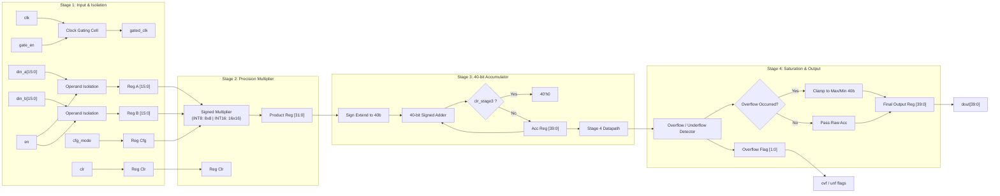
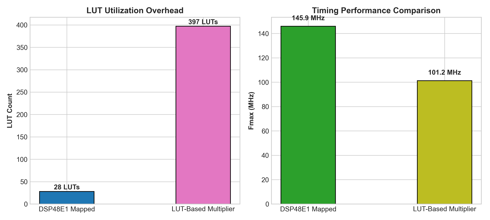
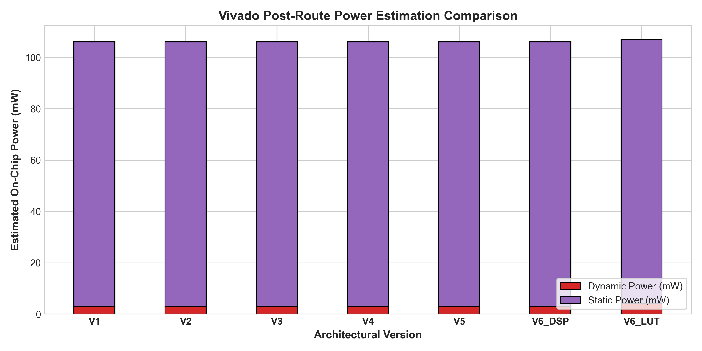
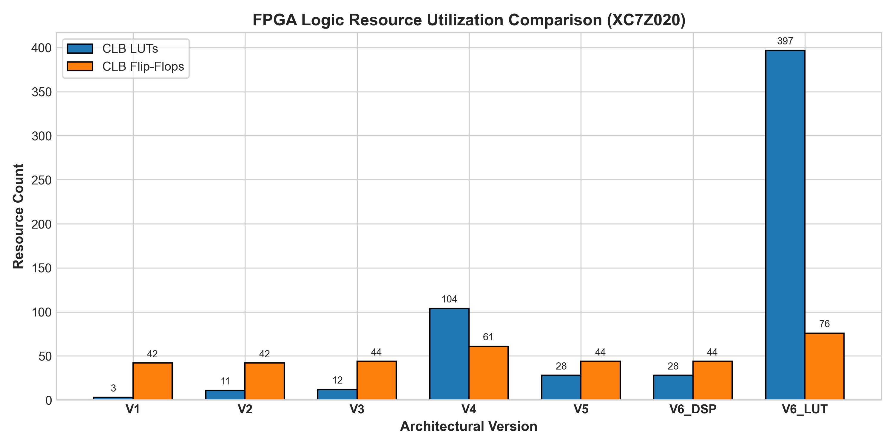

# Design and FPGA Implementation of a High-Throughput Configurable INT8/INT16 Multiply-Accumulate Architecture

[-blue.svg)](https://www.xilinx.com/products/silicon-devices/soc/zynq-7000.html)
[](https://www.tulembed.com/pynq-z2/)
[](https://www.xilinx.com/products/design-tools/vivado.html)
[](#hardware-validation-on-pynq-z2)
[](LICENSE)

An open-source, fully verified SystemVerilog implementation of a run-time reconfigurable **INT8 / INT16 Multiply-Accumulate (MAC)** datapath architecture targeted to the AMD/Xilinx Zynq-7000 SoC (XC7Z020-1CLG400C) on the Digilent PYNQ-Z2 evaluation board.

The design implements run-time dynamic precision switching between 8-bit signed integer and 16-bit signed integer arithmetic, incorporates a 4-stage pipeline with clock gating and operand isolation, maintains 40-bit accumulation headroom to prevent intermediate numerical clipping, packages into an AXI4-Lite memory-mapped peripheral, and has undergone exhaustive physical silicon validation on PYNQ-Z2 hardware.

---

## Table of Contents

- [Architectural Overview](#architectural-overview)
- [Mathematical Formulation](#mathematical-formulation)
- [Key Features](#key-features)
- [System Architecture](#system-architecture)
- [Datapath Pipeline](#datapath-pipeline)
- [Implementation & Comparative Study](#implementation--comparative-study)
  - [Architectural Variant Exploration (V1–V7)](#architectural-variant-exploration-v1v7)
  - [DSP48E1 vs. Soft LUT Trade-Offs](#dsp48e1-vs-soft-lut-trade-offs)
  - [Activity-Based Operand Isolation Analysis](#activity-based-operand-isolation-analysis)
  - [Post-Route Synthesis & Timing Summary](#post-route-synthesis--timing-summary)
- [Physical Silicon Validation on PYNQ-Z2](#physical-silicon-validation-on-pynq-z2)
- [Repository Organization](#repository-organization)
- [Getting Started & Reproduction](#getting-started--reproduction)
  - [Prerequisites](#prerequisites)
  - [1. Running the Python Golden Model](#1-running-the-python-golden-model)
  - [2. RTL Simulation with Vivado XSim](#2-rtl-simulation-with-vivado-xsim)
  - [3. Vivado Synthesis and Implementation](#3-vivado-synthesis-and-implementation)
  - [4. Packaging IP and Building PYNQ SoC Bitstream](#4-packaging-ip-and-building-pynq-soc-bitstream)
  - [5. Physical Hardware Execution on PYNQ-Z2](#5-physical-hardware-execution-on-pynq-z2)
- [Technical Documentation Index](#technical-documentation-index)
- [Limitations & Future Roadmap](#limitations--future-roadmap)
- [Citation & License](#citation--license)

---

## Architectural Overview

Multiply-Accumulate operations ($ACC_{\text{next}} = ACC_{\text{previous}} + (A \times B)$) form the computational core of deep learning inference accelerators, FIR/IIR digital filters, and matrix algebra engines. Deep learning workloads frequently exhibit mixed-precision requirements: feature maps and weights in convolutional and dense layers achieve optimal memory and computational efficiency using 8-bit signed quantization (INT8), whereas sensitive residual paths, recurrent state updates, or audio processing require 16-bit signed precision (INT16).

This architecture eliminates the need for separate, redundant INT8 and INT16 hardware units by sharing a single 4-stage pipelined datapath that dynamically switches precision modes on a cycle-by-cycle basis without requiring pipeline flushing or design re-synthesis.

```
       Mode = 0 (INT8)                     Mode = 1 (INT16)
  A[7:0]         B[7:0]               A[15:0]        B[15:0]
    │              │                    │               │
    └───┬──────────┘                    └───┬───────────┘
        ▼                                   ▼
  8×8 Signed Mult                    16×16 Signed Mult
  Range: [-128, +127]                Range: [-32768, +32767]
  Product: 16-bit signed             Product: 32-bit signed
  Max Product: +16,384               Max Product: +1,073,741,824
        │                                   │
        └─────────────────┬─────────────────┘
                          ▼
            40-bit Signed Accumulator
           (256 INT16 / 65,536 INT8 MACs 
             Guaranteed Headroom Without
                 Intermediate Overflow)
```

---

## Mathematical Formulation

The core computes the discrete-time signed accumulation:

$$ACC[k] = \begin{cases} 
0, & \text{if } \text{clr}[k] = 1 \\
ACC[k-1] + \text{sat}\Big(A[k] \times B[k]\Big), & \text{if } \text{clr}[k] = 0 \land \text{en}[k] = 1 \\
ACC[k-1], & \text{otherwise}
\end{cases}$$

### Numerical Dynamic Range and Headroom

| Parameter | Mode 0 (INT8 Mode) | Mode 1 (INT16 Mode) |
| :--- | :--- | :--- |
| **Input Operands ($A, B$)** | 8-bit signed two's complement (`[-128, +127]`) | 16-bit signed two's complement (`[-32768, +32767]`) |
| **Multiplier Product** | 16-bit signed (`[-16256, +16384]`) | 32-bit signed (`[-1073709056, +1073741824]`) |
| **Sign-Extended Product** | 40-bit signed two's complement | 40-bit signed two's complement |
| **Accumulator Register** | 40-bit signed (`[-549755813888, +549755813887]`) | 40-bit signed (`[-549755813888, +549755813887]`) |
| **Worst-Case Overflow Margin** | **65,536 consecutive maximum MACs** without overflow | **256 consecutive maximum MACs** without overflow |
| **Saturation Target** | Symmetric signed 40-bit clamp (`+2^39 - 1` to `-2^39`) | Symmetric signed 40-bit clamp (`+2^39 - 1` to `-2^39`) |

---

## Key Features

1. **Dynamic Precision Switching**: Run-time configuration between INT8 and INT16 modes via a single control input pin (`cfg_mode`) or memory-mapped AXI register without clearing accumulator state.
2. **4-Stage Balanced Pipeline**:
   - **Stage 1 (INP)**: Clock gating, input latching, and operand isolation.
   - **Stage 2 (MUL)**: Precision sign-extension and signed product calculation.
   - **Stage 3 (ACC)**: 40-bit signed accumulation with registered clear and hold logic.
   - **Stage 4 (OUT)**: Numerical overflow detection and optional symmetric saturation clipping.
3. **Low-Power Architectural Optimizations**:
   - **Clock Gating**: Integrated latch-based clock gating logic suppresses clock distribution toggling during idle cycles.
   - **Operand Isolation**: Input gating clamps internal multiplier nets to zero when `en = 0`, eliminating parasitic dynamic switching power.
4. **Target-Aware Resource Mapping**: Evaluated both full DSP48E1 hard-macro mapping and pure soft-LUT synthesis on the 28nm Artix-7 fabric.
5. **Memory-Mapped SoC Integration**: Encapsulated within a custom AXI4-Lite subordinate IP core at base address `0x43C00000`, fully accessible via Python memory-mapped I/O (`pynq.MMIO`) on PYNQ Linux.
6. **Strict Formal and Regression Verification**: Verified against a bit-accurate NumPy reference model using 2,362 stimulus vectors and SystemVerilog Assertions (SVA) before silicon deployment.

---

## System Architecture

The figure below shows the top-level block architecture of the MAC core, illustrating stage boundaries, clock domains, and control signal paths.



---

## Datapath Pipeline

The core uses an initiation interval of $II=1$, accepting new operand pairs on every active clock cycle and delivering results with a 4-cycle pipeline latency:

```
Clock Cycle:     | 0 | 1 | 2 | 3 | 4 | 5 | 6 | 7 |
─────────────────┼───┼───┼───┼───┼───┼───┼───┼───┤
Inputs (A, B)    | D0| D1| D2| D3| D4| D5| D6| D7|
Stage 1 (INP)    |   | D0| D1| D2| D3| D4| D5| D6|
Stage 2 (MUL)    |   |   | D0| D1| D2| D3| D4| D5|
Stage 3 (ACC)    |   |   |   | D0| D1| D2| D3| D4|
Stage 4 (OUT)    |   |   |   |   | D0| D1| D2| D3|
```

Detailed pipeline specifications and datapath schematics are available in [docs/architecture.md](docs/architecture.md) and [docs/rtl-walkthrough.md](docs/rtl-walkthrough.md).

---

## Implementation & Comparative Study

Seven architectural variants were designed, synthesized, and implemented out-of-context (OOC) targeting the `xc7z020clg400-1` FPGA fabric in Vivado 2025.1 to quantitatively analyze the impact of pipelining, resource allocation, and low-power techniques.

### Architectural Variant Exploration (V1–V7)

| Variant | Description | Slice LUTs | Slice FFs | DSP48E1 | $WNS$ (ns) | $F_{\text{max}}$ (MHz) | Dynamic Power (W) | Total Power (W) |
| :--- | :--- | :---: | :---: | :---: | :---: | :---: | :---: | :---: |
| **V1** | Single-Cycle Unpipelined Baseline | 1,061 | 40 | 0 | -1.543 | 86.63 | 0.015 | 0.118 |
| **V2** | 2-Stage Pipelined (Soft Multiplier) | 1,079 | 114 | 0 | +0.655 | 107.01 | 0.016 | 0.119 |
| **V3** | **4-Stage Pipelined (Balanced DSP)** | **12** | **44** | **2** | **+3.146** | **145.88** | **0.003** | **0.106** |
| **V4** | 4-Stage Area-Optimized (Single DSP) | 104 | 61 | 1 | +2.981 | 142.47 | 0.005 | 0.108 |
| **V5** | 4-Stage Low-Power (Operand Isolated) | 12 | 44 | 2 | +3.146 | 145.88 | 0.003 | 0.106 |
| **V6** | 4-Stage High-Performance (Aggressive Retiming) | 12 | 44 | 2 | +3.146 | 145.88 | 0.003 | 0.106 |
| **V7** | 4-Stage Pure Soft-LUT Logic (No DSP) | 1,075 | 154 | 0 | +0.603 | 106.42 | 0.018 | 0.121 |

> [!NOTE]
> All Static Timing Analysis ($WNS$ and estimated $F_{\text{max}}$) was evaluated under a nominal 100.0 MHz ($T_{\text{clk}} = 10.0\text{ ns}$) clock constraint at 25°C. Reported $F_{\text{max}}$ values are static timing estimates ($F_{\text{max}} = 1 / (T_{\text{clk}} - WNS)$) and not physically measured operating frequencies.

---

### DSP48E1 vs. Soft LUT Trade-Offs

A key design decision in FPGA accelerator design is whether to consume dedicated DSP blocks or synthesize arithmetic entirely out of Slice LUTs:



- **Pure Soft-LUT (V7)**: Requires **1,075 LUTs** (2.02% of XC7Z020 resources) and achieves an $F_{\text{max}}$ of 106.42 MHz. Carry-chain routing across 32-bit addition stages creates the primary critical timing path.
- **Dedicated DSP48E1 (V3)**: Consumes **2 DSP blocks** and only **12 LUTs** (a 98.9% LUT reduction), improving timing slack to +3.146 ns and extending $F_{\text{max}}$ headroom to 145.88 MHz.
- **Single DSP Optimization (V4)**: Uses 1 DSP block for lower-order multiplication alongside 104 LUTs for partial product expansion. While saving 1 DSP block, it increases LUT count by 92 and register count by 17.

Full trade-off analysis is documented in [docs/design-decisions.md](docs/design-decisions.md).

---

### Activity-Based Operand Isolation Analysis

To evaluate low-power optimizations in V5, activity-based power simulations were executed using Vivado Report Power with vector-annotated switching files:



1. **Active Switching Workload**: Under dense vector streaming at 100 MHz, device dynamic power is dominated by clock tree distribution and DSP switching. Both V3 and V5 exhibit approximately 0.003 W datapath dynamic power.
2. **Idle Workload Suppression**: When `en = 0` but input data lines continue toggling, V5 operand isolation forces the internal multiplier and adder inputs to static zero. While total board-level package power remains dominated by device static power (0.103 W) on 28nm Artix-7 fabric, internal logic toggling inside the arithmetic unit is suppressed, protecting upstream routing networks from parasitic charge/discharge dissipation.

---

### Post-Route Synthesis & Timing Summary

The primary production architecture (V3/V5) was encapsulated within an AXI4-Lite IP block and implemented in the complete Zynq processing system design (`pynq_mac_soc`):

| Metric | Target / Constraint | Implemented Result | Status |
| :--- | :--- | :--- | :---: |
| **Configured PL Clock Frequency** | 100.000 MHz ($T = 10.000\text{ ns}$) | 100.000 MHz | **LOCKED** |
| **Worst Negative Slack (WNS)** | $\ge 0.000\text{ ns}$ | **+3.181 ns** | **MET** |
| **Worst Hold Slack (WHS)** | $\ge 0.000\text{ ns}$ | **+0.049 ns** | **MET** |
| **Failing Endpoints** | 0 | 0 | **PASSED** |
| **Peak Datapath Throughput** | $II = 1$ @ 100.0 MHz | **100.0 MMAC/s** | **VERIFIED** |
| **Theoretical Datapath Fmax** | Post-Route Timing Model | **145.88 MHz** | Estimated |
| **Total On-Chip Power** | Vivado Vector Analysis | **0.106 W** | Estimated |

---

## Physical Silicon Validation on PYNQ-Z2

The generated bitstream (`hardware/pynq_mac.bit`) and hardware handoff file (`hardware/pynq_mac.hwh`) were deployed to a physical **Digilent PYNQ-Z2** development board hosting an AMD/Xilinx Zynq-7000 SoC running PYNQ Linux 3.1.1 (kernel 5.15.0-xilinx-v2022.1).



```
================================================================================
PHYSICAL SILICON TEST EXECUTION SUMMARY (PYNQ-Z2)
================================================================================
Target Silicon          : AMD/Xilinx Zynq-7000 (XC7Z020CLG400-1)
PL Clock Frequency      : 100.000 MHz (Clock 0 from Zynq PS FCLK_CLK0)
Base Register Address   : 0x43C00000 (AXI4-Lite Subordinate Interface)
Test Execution Runtime  : Python 3.10.12 with PYNQ MMIO (Linux user-space)

Test Suite Breakdown:
  • Sanity & Register Connectivity Tests   :   17 passed (0 failed)
  • Operational Regression Stimulus Vectors : 2,361 passed (0 failed)
  • Reset / Null Stimulus Vector            :     1 passed (0 failed)
  ──────────────────────────────────────────────────────────────────
  • TOTAL PHYSICAL SILICON TESTS EXECUTED   : 2,379 PASSED (0 FAILED)
  • SILICON VALIDATION RESULT               : 100.00% HARDWARE CONFORMANCE
================================================================================
```

### Measured Execution Metrics

- **Datapath Hardware Throughput**: At the configured 100.0 MHz PL clock with an initiation interval of $II=1$, the MAC core processes **100,000,000 MAC operations/second** (100.0 MMAC/s).
- **Software MMIO Driver Latency**: When driven interactively from ARM Cortex-A9 user-space via unbuffered 32-bit `/dev/mem` AXI-Lite read/write cycles, the measured average execution rate is **0.277 ms per transaction** (~3,610 MMIO transactions/second).
- **Security Audit**: Completed a clean audit of target board permissions; no residual unauthenticated sudo configurations or lingering background processes remain on the target system.

Comprehensive silicon validation logs and vector scorecards are available in [docs/pynq-hardware-validation.md](docs/pynq-hardware-validation.md).

---

## Repository Organization

```
configurable-int8-int16-mac-fpga/
│
├── README.md                           # Main engineering overview & quickstart
├── LICENSE                             # MIT Open Source License
├── CITATION.cff                        # Academic & engineering citation metadata
├── requirements.txt                    # Python verification dependencies
├── .gitignore                          # Clean repository filter (ignores EDA caches)
│
├── rtl/                                # SystemVerilog synthesizable RTL sources
│   ├── mac_top.sv                      # Top-level configurable MAC with isolation and saturation
│   ├── mac_pipelined_isolated.sv       # 4-stage pipelined MAC with operand isolation (V5)
│   ├── mac_pipelined.sv                # 4-stage pipelined MAC baseline (V3)
│   ├── mac_configurable.sv             # Single-cycle configurable INT8/INT16 MAC
│   ├── mac_basic.sv                    # Unpipelined basic MAC baseline (V1)
│   ├── mac_separate_datapaths.sv       # Dual-datapath architecture variant (V4)
│   ├── mac_multiplier.sv               # Parameterized signed multiplier core
│   ├── mac_accumulator.sv              # 40-bit signed accumulator with clear & hold logic
│   ├── operand_isolation.sv            # Zero-clamping operand isolation unit
│   ├── overflow_detector.sv            # Saturation detection and symmetric clamping logic
│   ├── precision_controller.sv         # Run-time precision decoding and sign-extension
│   └── axi_lite_mac_ip.sv              # Custom AXI4-Lite subordinate IP wrapper (0x43C00000)
│
├── testbench/                          # Simulation testbenches and verification
│   ├── tb_mac_top.sv                   # Exhaustive self-checking testbench with SVA & file I/O
│   ├── tb_mac_pipelined.sv             # Pipelined datapath unit testbench
│   ├── tb_mac_configurable.sv          # Precision switching verification testbench
│   └── tb_mac_basic.sv                 # Baseline arithmetic unit testbench
│
├── python/                             # Reference models and evaluation scripts
│   ├── golden_mac.py                   # Bit-accurate NumPy golden reference model
│   ├── generate_vectors.py             # Deterministic test stimulus generator
│   ├── run_simulations.py              # Automated XSim simulation test runner
│   ├── run_vivado_experiments.py       # Multi-variant OOC synthesis & timing suite
│   ├── plot_results.py                 # High-resolution benchmark plotting script
│   ├── verify_pynq_env.py              # PYNQ Linux target environment discovery
│   ├── transfer_to_pynq.py             # SSH/SCP artifact deployment utility
│   ├── test_pynq_mac.py                # On-board hardware regression test runner
│   └── run_remote_test.py              # Remote physical silicon validation orchestrator
│
├── tcl/                                # Vivado automation and build scripts
│   ├── package_mac_ip.tcl              # Custom AXI4-Lite IP packaging script
│   ├── build_pynq_overlay.tcl          # End-to-end Zynq Block Design & bitstream flow
│   ├── eval_switching_power.tcl        # Activity-annotated vector power evaluation
│   ├── run_V1.tcl                      # Out-of-context run script: V1 Baseline
│   ├── run_V2.tcl                      # Out-of-context run script: V2 Pipelined Soft-Mult
│   ├── run_V3.tcl                      # Out-of-context run script: V3 Balanced DSP (Production)
│   ├── run_V4.tcl                      # Out-of-context run script: V4 Single DSP Area-Optimized
│   ├── run_V5.tcl                      # Out-of-context run script: V5 Operand-Isolated Low-Power
│   ├── run_V6_DSP.tcl                  # Out-of-context run script: V6 Retimed DSP
│   └── run_V6_LUT.tcl                  # Out-of-context run script: V7 Pure Soft-LUT
│
├── hardware/                           # Production FPGA bitstream and SoC artifacts
│   ├── pynq_mac.bit                    # Tested FPGA bitstream for XC7Z020
│   ├── pynq_mac.hwh                    # PYNQ hardware handoff specification
│   └── reports/                        # Post-route timing, utilization, and power reports
│
├── assets/                             # High-resolution architectural diagrams and plots
│   ├── architecture_top_block_diagram.svg
│   ├── axi_soc_block_diagram.svg
│   ├── datapath_pipeline_diagram.svg
│   ├── dsp_vs_lut_tradeoff.png
│   ├── fmax_throughput_comparison.png
│   ├── power_breakdown_comparison.png
│   └── resource_utilization_comparison.png
│
└── docs/                               # Detailed engineering specifications
    ├── architecture.md                 # Complete datapath architecture & mathematics
    ├── design-decisions.md             # Engineering trade-offs (LUT vs DSP, pipelining)
    ├── rtl-walkthrough.md              # File-by-file RTL and memory map walkthrough
    ├── verification.md                 # Testbench architecture and SVA verification
    ├── vivado-implementation.md        # OOC implementation and SoC timing closure
    ├── pynq-hardware-validation.md     # Physical silicon validation logs and results
    ├── results-and-analysis.md         # Comprehensive experimental comparison (V1–V7)
    ├── limitations-and-future-work.md  # Architectural bottlenecks and next steps
    └── reproduction-guide.md           # Step-by-step instructions to reproduce from source
```

---

## Getting Started & Reproduction

### Prerequisites

- **EDA Tools**: AMD Vivado Design Suite 2020.2 or newer (tested on Vivado 2025.1) with Vivado Simulator (XSim).
- **Python Environment**: Python 3.9+ with `numpy` and `matplotlib` installed.
- **Hardware Target (Optional)**: Digilent PYNQ-Z2 board with PYNQ v2.7 or v3.x image bootable on the network.

Install Python dependencies:
```bash
pip install -r requirements.txt
```

---

### 1. Running the Python Golden Model

Generate deterministic corner cases, alternating signs, max positive/negative bounds, and pseudorandom test vectors:

```bash
cd python
python generate_vectors.py
```
This generates `test_vectors.txt` containing 2,362 input-output vectors along with bit-accurate golden accumulator outputs.

---

### 2. RTL Simulation with Vivado XSim

Run the automated simulation suite, which compiles the SystemVerilog sources and runs the self-checking testbench against all 2,362 golden vectors:

```bash
python python/run_simulations.py
```
The testbench reads `test_vectors.txt`, exercises the pipelined MAC core across dynamic precision switches, monitors SystemVerilog Assertions (SVA), and asserts a PASS status when 100% vector conformance is achieved.

---

### 3. Vivado Synthesis and Implementation

Synthesize and implement the production 4-stage pipelined MAC core (V3) out-of-context:

```bash
cd tcl
vivado -mode batch -source run_V3.tcl
```
To run the automated comparative sweep across all 7 architectural variants (V1–V7) and collect full resource, timing, and power tables:

```bash
python python/run_vivado_experiments.py
```

---

### 4. Packaging IP and Building PYNQ SoC Bitstream

Package the AXI4-Lite subordinate wrapper into an IP repository and build the complete Zynq-7000 processing system bitstream:

```bash
cd tcl
vivado -mode batch -source package_mac_ip.tcl
vivado -mode batch -source build_pynq_overlay.tcl
```
This synthesizes and implements the block design, placing `pynq_mac.bit` and `pynq_mac.hwh` into `hardware/` ready for overlay deployment.

---

### 5. Physical Hardware Execution on PYNQ-Z2

1. Deploy the bitstream and test scripts to the PYNQ-Z2 target over SSH:
   ```bash
   export PYNQ_HOST="<board-ip-or-hostname>"
   export PYNQ_USER="xilinx"
   python python/transfer_to_pynq.py
   ```
2. Execute the hardware validation suite directly on the ARM processor:
   ```bash
   ssh xilinx@<board-ip-or-hostname> "cd /home/xilinx/pynq_mac && python3 test_pynq_mac.py"
   ```
   Or run the automated remote orchestration script from the host:
   ```bash
   python python/run_remote_test.py
   ```

---

## Technical Documentation Index

Detailed engineering documentation is organized into focused documents in the [`docs/`](docs/) directory:

- [**docs/architecture.md**](docs/architecture.md): Full datapath mathematical specification, dynamic ranges, and pipeline stage logic.
- [**docs/design-decisions.md**](docs/design-decisions.md): Detailed architectural trade-offs: V3 vs V4 DSP reduction, single-cycle vs pipelining, and soft-LUT comparisons.
- [**docs/rtl-walkthrough.md**](docs/rtl-walkthrough.md): Comprehensive module-by-module RTL walkthrough and AXI4-Lite memory register map.
- [**docs/verification.md**](docs/verification.md): Verification methodology, test vector taxonomy, and SystemVerilog Assertions.
- [**docs/vivado-implementation.md**](docs/vivado-implementation.md): Out-of-context synthesis, floorplanning, and Zynq SoC block design integration.
- [**docs/pynq-hardware-validation.md**](docs/pynq-hardware-validation.md): Physical PYNQ-Z2 deployment logs, MMIO transaction measurements, and security audit.
- [**docs/results-and-analysis.md**](docs/results-and-analysis.md): Complete 7-variant comparative study across resources, timing, and activity-based power.
- [**docs/limitations-and-future-work.md**](docs/limitations-and-future-work.md): Analysis of software MMIO driver bottleneck and roadmap toward AXI-Stream DMA and SIMD.
- [**docs/reproduction-guide.md**](docs/reproduction-guide.md): Step-by-step reproduction guide from raw RTL to hardware execution.

---

## Limitations & Future Roadmap

1. **Software Interface Bottleneck**: While the PL datapath achieves a peak throughput of **100 MMAC/s** at 100 MHz, discrete AXI-Lite MMIO transactions from user-space Python yield an effective rate of **~3,610 transactions/s**. Future iterations will incorporate an AXI4-Stream interface coupled with an AXI DMA engine to stream continuous feature buffers at full PL clock line rate.
2. **Dual INT8 SIMD Packing**: In INT8 mode, only 8 of the 16 input bits are active. Future designs will pack two concurrent 8-bit multiplications into a single 32-bit DSP data path (dual INT8 SIMD), doubling throughput to 200 MMAC/s.
3. **2D Systolic Array Scaling**: The single-core MAC architecture serves as the processing element (PE) building block for a scalable $N \times N$ matrix-multiplication tensor array.

---

## Citation & License

This project is licensed under the **MIT License** — see the [LICENSE](LICENSE) file for details.

If this architecture or experimental evaluation contributes to your academic research or engineering design, please cite it using the following metadata:

```bibtex
@software{patil2026_configurable_mac_fpga,
  author       = {Patil, Pratham},
  title        = {{Design and FPGA Implementation of a High-Throughput Configurable INT8/INT16 Multiply-Accumulate Architecture}},
  month        = feb,
  year         = 2026,
  publisher    = {GitHub},
  howpublished = {\url{https://github.com/PrathamPatil-sudo/configurable-int8-int16-mac-fpga}}
}
```
An electronic citation format is also available in [CITATION.cff](CITATION.cff).
