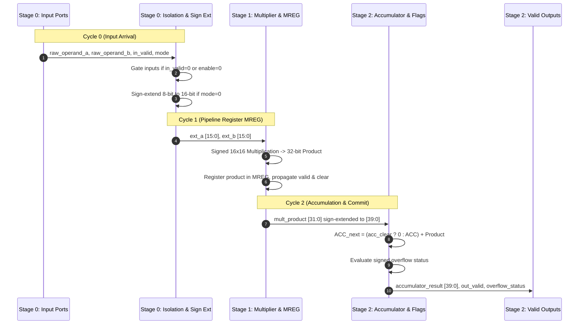

# Hardware Architecture Specification

## 1. Architectural Overview

Multiply-Accumulate (MAC) units represent the computational core of modern digital signal processors, embedded vision engines, and deep neural network accelerators. The fundamental arithmetic operation evaluated on every active clock cycle is:

$$\text{ACC}_{\text{next}} = \text{ACC}_{\text{previous}} + (A \times B)$$

In edge computing platforms, machine learning workloads increasingly leverage mixed-precision quantization. Convolutional and dense layers frequently deploy 8-bit signed integers ($\text{INT8}$) for weight matrices and activation maps to minimize memory bandwidth and off-chip DRAM accesses. Conversely, critical layers, high-dynamic-range sensor filters, or accumulator-sensitive feedback loops require 16-bit signed integer ($\text{INT16}$) precision.

This project implements a fully parameterizable, hardware-efficient MAC architecture capable of dynamically switching between signed $\text{INT8}$ and $\text{INT16}$ arithmetic on a cycle-by-cycle basis, utilizing a shared multiplier datapath, dynamic operand isolation, and a 40-bit carry-propagate accumulator.

---

## 2. Top-Level System Architecture

The complete system integrates the arithmetic compute datapath into a memory-mapped System-on-Chip (SoC) environment on the AMD/Xilinx Zynq-7000 XC7Z020 FPGA:

```mermaid
graph TB
    subgraph Processing_System ["Zynq-7000 Processing System (PS)"]
        ARM["Dual-Core ARM Cortex-A9 @ 650 MHz"]
        DDR["DDR3 Memory Controller (512 MB)"]
        PYNQ_API["Python 3 / PYNQ Linux (MMIO Driver)"]
        ARM --- DDR
        ARM --- PYNQ_API
    end

    subgraph Interconnect ["AXI Interconnect Subsystem"]
        M_AXI["M_AXI_GP0 (Master AXI4-Lite)"]
        AXI_IC["AXI Interconnect (Clock: 100 MHz)"]
        RST_GEN["Proc Sys Reset (Synchronous Reset)"]
        M_AXI --> AXI_IC
    end

    subgraph Custom_IP ["axi_lite_mac_ip (Base: 0x43C00000)"]
        AXI_SLV["AXI4-Lite Slave Interface"]
        REG_BANK["Memory-Mapped Register Bank<br/>Control | Mode | OpA | OpB | Status | ResLow | ResHigh"]
        AXI_SLV <--> REG_BANK
    end

    subgraph MAC_Core ["Programmable Logic MAC Datapath (mac_top)"]
        ISO["Operand Isolation Stage"]
        PREC["Precision Controller & Sign Extension"]
        MULT["Pipelined Multiplier Stage (MREG)"]
        ACC["40-Bit Carry-Propagate Accumulator"]
        OVF["Signed Overflow Detector"]

        ISO --> PREC
        PREC --> MULT
        MULT --> ACC
        MULT --> OVF
        ACC --> OVF
    end

    PYNQ_API ==>|MMIO Read/Write| M_AXI
    AXI_IC ==>|32-bit AXI4-Lite Bus| AXI_SLV
    REG_BANK ==>|Operand & Control Signals| ISO
    ACC ==>|Accumulator Output [39:0]| REG_BANK
    OVF ==>|Overflow & Valid Flags| REG_BANK
```

---

## 3. Arithmetic Formulations & Dynamic Ranges

Both operands ($A$ and $B$) are treated as two's-complement signed integers. The precision mode is controlled dynamically via a single control bit (`precision_mode`):
- `precision_mode = 1'b0`: **INT8 Mode** (Operands restricted to lower 8 bits, sign-extended to 16 bits).
- `precision_mode = 1'b1`: **INT16 Mode** (Operands span full 16-bit signed dynamic range).

### Precision and Numerical Dynamic Ranges

| Parameter | INT8 Mode (`mode = 0`) | INT16 Mode (`mode = 1`) |
|:---|:---:|:---:|
| **Operand Width** | 8 bits signed | 16 bits signed |
| **Minimum Operand ($X_{\text{min}}$)** | $-128$ (`0x80`) | $-32,768$ (`0x8000`) |
| **Maximum Operand ($X_{\text{max}}$)** | $+127$ (`0x7F`) | $+32,767$ (`0x7FFF`) |
| **Product Bit-Width** | 16 bits signed | 32 bits signed |
| **Minimum Product ($P_{\text{min}}$)** | $-128 \times +127 = \mathbf{-16,256}$ (`0xC080`) | $-32,768 \times +32,767 = \mathbf{-1,073,709,056}$ |
| **Maximum Product ($P_{\text{max}}$)** | $-128 \times -128 = \mathbf{+16,384}$ (`0x4000`) | $-32,768 \times -32,768 = \mathbf{+1,073,741,824}$ |
| **Accumulator Bit-Width** | 40 bits signed | 40 bits signed |
| **Accumulator Guard Bits** | 24 bits ($40 - 16$) | 8 bits ($40 - 32$) |
| **Worst-Case Accumulation Headroom** | $2^{24} = \mathbf{16,777,216}$ additions | $2^8 = \mathbf{256}$ additions |

### Mathematical Correction Note
In some preliminary literature, the minimum product for signed 8-bit integers is erroneously reported as $-16,129$ (arising from $-(127 \times 127)$). In two's-complement arithmetic, negative numbers have asymmetric range ($[-2^{N-1}, 2^{N-1}-1]$). The true minimum product is strictly:

$$P_{\text{min, INT8}} = -128 \times +127 = -16,256$$

The true maximum product is:

$$P_{\text{max, INT8}} = -128 \times -128 = +16,384$$

---

## 4. Internal Datapath Stages

The MAC datapath is partitioned into three balanced pipeline stages to maximize clock frequency while keeping latency deterministic:



### Stage 0: Operand Isolation & Precision Steering
1. **Dynamic Operand Gating:** When `in_valid = 0` or `enable = 0`, input operand buses are clamped to zero before entering the combinational multiplier tree. This prevents spurious signal toggling on shared input buses from propagating into DSP multiplier logic during idle clock cycles.
2. **Sign Extension:** In INT8 mode (`precision_mode = 0`), bits `[7:0]` of each operand are sign-extended to 16 bits using their sign bit (`raw_operand[7]`). In INT16 mode (`precision_mode = 1`), the full 16-bit word is passed unchanged.

### Stage 1: Pipelined Multiplier ($MREG$)
- Multiplies two signed 16-bit integers ($ext\_a \times ext\_b$) yielding a 32-bit signed product.
- When mapped to Xilinx DSP48E1 slices, this stage activates internal DSP pipeline registers (`MREG = 1`), physically isolating the multiplier array from the downstream accumulation carry-chains.
- Latency: Exactly 1 clock cycle.

### Stage 2: Accumulator & Signed Overflow Detection
- The 32-bit product is sign-extended to 40 bits and accumulated onto the running 40-bit register:
  $$ACC[39:0] \leftarrow \begin{cases} 40\text{'sh0} + \text{sign\_ext}(Product), & \text{if } acc\_clear = 1 \\ ACC[39:0] + \text{sign\_ext}(Product), & \text{if } enable = 1 \text{ and } mult\_valid = 1 \\ ACC[39:0], & \text{otherwise} \end{cases}$$
- **Signed Overflow Detection:** Evaluated concurrently using two's-complement arithmetic sign bits:
  $$\text{overflow\_status} = (\overline{ACC[39]} \land \overline{Product[39]} \land Sum[39]) \lor (ACC[39] \land Product[39] \land \overline{Sum[39]})$$
  An overflow flag asserts if two positive numbers sum to a negative result, or two negative numbers sum to a positive result.
- Latency from input to valid output: **2 clock cycles**. Initiation Interval: **1 clock cycle/operation**.

---

## 5. Accumulator Headroom Analysis

Selecting the accumulator bit width is a fundamental architectural decision in MAC design:

1. **32-bit Accumulator (Insufficient):** A 32-bit accumulator offers zero guard bits for INT16 products. A single multiplication of $-32,768 \times -32,768 = +1,073,741,824$ fills 31 bits. Two consecutive maximum products immediately cause an arithmetic overflow ($2 \times 1,073,741,824 = 2,147,483,648$, which exceeds the 32-bit signed maximum $+2,147,483,647$).
2. **40-bit Accumulator (Selected):**
   - For INT16 mode, provides **8 guard bits**, allowing $2^8 = 256$ consecutive maximum-magnitude product additions without overflow. In typical zero-mean distributed neural network weights, several thousand accumulation cycles proceed before risk of overflow.
   - For INT8 mode, provides **24 guard bits**, permitting $2^{24} = 16,777,216$ consecutive additions without numerical overflow.
   - 40 bits maps efficiently into FPGA DSP48E1 slices, which natively support 48-bit internal accumulation paths.
