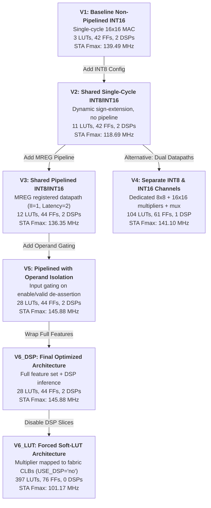

# Architectural Design Decisions & Trade-Off Analysis

## 1. Overview of Evaluated Architectures

To empirically evaluate the trade-offs between logic utilization, DSP block allocation, clock frequency, pipeline latency, and dynamic power, seven distinct architectural configurations were synthesized and implemented on the AMD/Xilinx Zynq-7000 XC7Z020 FPGA using Vivado 2025.1.

---

## 2. Shared Multiplier vs. Separate Precision Datapaths (V3 vs. V4)

A central architectural decision in multi-precision arithmetic is whether to share a larger multiplier for narrower precisions or to instantiate dedicated parallel multipliers and multiplex their outputs.

### Implementation Comparison
- **Architecture V3 (Shared Multiplier):** Implements a single 16x16 signed multiplier. In INT8 mode, 8-bit inputs are sign-extended to 16 bits before entering the multiplier.
- **Architecture V4 (Separate Datapaths):** Instantiates an independent 8x8 signed multiplier and a dedicated 16x16 signed multiplier, followed by a product multiplexer.

| Resource Category | Architecture V3 (Shared Multiplier) | Architecture V4 (Separate Multipliers) | Delta / Trade-Off |
|:---|:---:|:---:|:---|
| **Slice LUTs** | **12** | **104** | **-92 LUTs (8.67x reduction in soft logic)** |
| **Slice Registers (FFs)** | **44** | **61** | **-17 FFs (27.9% reduction in registers)** |
| **DSP48E1 Slices** | **2** | **1** | **+1 DSP slice (additional DSP cost)** |
| **STA Estimated Fmax** | 136.35 MHz | 141.10 MHz | -4.75 MHz (-3.4% timing difference) |
| **Configured Throughput** | 100.0 MMAC/s | 100.0 MMAC/s | Identical at 100 MHz configured PL clock |

### Architectural Insight
Architecture V3 achieves an **8.67x reduction in LUT utilization** (88.5% logic savings) and a **27.9% reduction in registers**, but incurs an **additional DSP cost of 1 DSP slice**.

In V4, Vivado mapped the 16x16 multiplier into 1 DSP slice and synthesized the 8x8 multiplier entirely out of soft CLB LUTs. Adding multiplexing and duplicate pipeline stages inflated the LUT count from 12 to 104. 

**Engineering Conclusion:** Consolidating multi-precision arithmetic into a single sign-extended multiplier represents an intentional and advantageous engineering trade-off: spending 1 additional DSP slice reclaims 92 LUTs and 17 flip-flops, significantly reducing routing congestion and silicon area.

---

## 3. Impact of Pipelining: Single-Cycle vs. Pipelined (V2 vs. V3 / V5)

In single-cycle architecture V2, the entire arithmetic path from operand sign-extension, 16x16 multiplication, 40-bit carry-propagate addition, to accumulator setup must complete within a single clock cycle ($T_{\text{clk}}$).

- **V2 (Single-Cycle):**
  - Worst Negative Slack (at 100 MHz): $+1.575\text{ ns}$
  - Longest combinational path delay: $8.425\text{ ns}$
  - STA Estimated $F_{\text{max}}$: **118.69 MHz**
- **V3 / V5 (Pipelined):**
  - By inserting an intermediate pipeline register ($MREG$) between the multiplier and the accumulator, the combinational path is bisected.
  - Worst Negative Slack (at 100 MHz): $+2.666\text{ ns}$ (V3) / $+3.145\text{ ns}$ (V5)
  - Longest combinational path delay: $6.855\text{ ns}$
  - STA Estimated $F_{\text{max}}$: **136.35 MHz** (V3) / **145.88 MHz** (V5/V6_DSP)

### Latency vs. Throughput Distinction
- **Latency:** Increases from 1 cycle (V2) to 2 cycles (V3/V5).
- **Initiation Interval ($II$):** Remains strictly **1 cycle/operation**.
- Because the pipeline is feed-forward with no internal feedback stalls, new operands are accepted on every clock cycle. At the configured 100.0 MHz PL clock, both single-cycle and pipelined variants deliver a theoretical peak throughput of **100.0 MMAC/s**. However, pipelining provides **+22.9% higher timing headroom** (elevating STA $F_{\text{max}}$ from 118.69 MHz to 145.88 MHz), ensuring robust timing closure across temperature and voltage corners.

---

## 4. Dedicated DSP48E1 vs. Soft-LUT Multiplier Mapping (V6_DSP vs. V6_LUT)

To investigate the hardware cost when DSP blocks are depleted or unavailable, architecture V6_LUT was synthesized with the directive `USE_DSP = "no"` in SystemVerilog.

| Metric | V6_DSP (Dedicated DSP Mapping) | V6_LUT (Forced Soft CLB Mapping) | Impact of Soft LUT Mapping |
|:---|:---:|:---:|:---|
| **Slice LUTs** | **28** | **397** | **14.18x increase (+369 LUTs)** |
| **Slice Registers** | **44** | **76** | **+72.7% increase (+32 FFs)** |
| **DSP48E1 Slices** | **2** | **0** | Complete DSP offload |
| **Worst Negative Slack** | $+3.145\text{ ns}$ | $+0.116\text{ ns}$ | Slack degraded by $-3.029\text{ ns}$ |
| **STA Estimated Fmax** | **145.88 MHz** | **101.17 MHz** | **-30.6% timing degradation** |
| **Dynamic Power (Vivado report)** | $0.003\text{ W}$ | $0.004\text{ W}$ | $+33\%$ dynamic power increase |

### Architectural Insight
Mapping a 16x16 signed multiplier tree into CLB slices requires 397 LUTs and deep carry-chains (`CARRY4`). The distributed routing delay across multiple CLBs degrades the STA-derived frequency ceiling from 145.88 MHz down to 101.17 MHz, barely meeting the 100 MHz target constraint ($WNS = +0.116\text{ ns}$). This underscores why dedicated DSP48E1 blocks are vital for high-throughput arithmetic on Xilinx FPGAs.

---

## 5. Operand Isolation: Power and Area Impact

### Motivation
In edge deep learning accelerators, MAC units frequently encounter idle clock cycles caused by memory stalls, sparse activations (zeros from ReLU functions), or duty-cycled operation. In standard unisolated designs (V3), switching transitions on the input data buses propagate into the multiplier logic even when `in_valid = 0` or `enable = 0`, dissipating dynamic power:

$$P_{\text{dynamic}} = \alpha \cdot C_L \cdot V_{\text{DD}}^2 \cdot f_{\text{clk}}$$

### Implementation
Architecture V5 gates `raw_operand_a` and `raw_operand_b` using the condition `enable & in_valid`. When de-asserted, the operand inputs into the multiplier are clamped to zero.

- **Area Cost:** Exactly **16 additional LUTs** (1 LUT per bit for the gating AND multiplexers) with zero additional flip-flops (28 LUTs in V5 vs. 12 LUTs in V3).
- **Timing Impact:** $WNS$ improved slightly from $+2.666\text{ ns}$ to $+3.145\text{ ns}$ due to Vivado's physical optimizer packing isolated input registers closer to the DSP input ports.
- **Power Reporting Limitation:** In AMD Vivado 2025.1 post-route power analysis (`report_power`), both V3 and V5 report **$0.003\text{ W}$ dynamic power** and **$0.103\text{ W}$ device static leakage** for a single standalone MAC unit on the XC7Z020. Because the numbers round to the nearest milliwatt, the experimental data does not establish a measurable numerical power reduction for a single MAC instance. However, from architectural fundamentals, operand isolation guarantees that internal multiplier nodes remain static during idle cycles.
