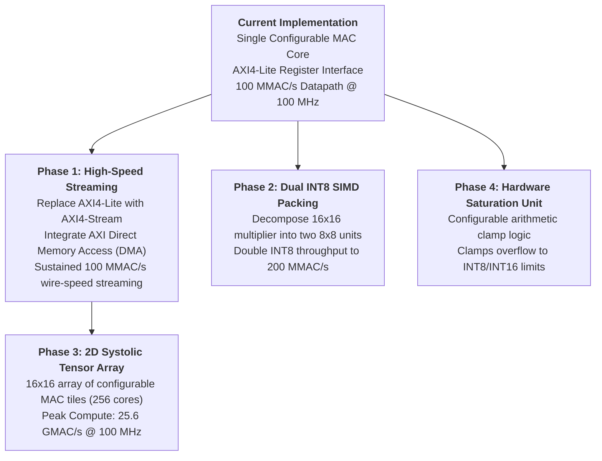

# Engineering Limitations & Future Enhancements

## 1. Current Engineering Limitations

To maintain technical honesty and academic rigor, several practical engineering constraints and limitations of the current implementation must be acknowledged:

### 1.1 Software-Interface Communication Bottleneck (AXI4-Lite vs. Datapath)
- **The Limitation:** While the hardware datapath in programmable logic processes operands at a peak rate of **100.0 MMAC/s** ($1.00 \times 10^8$ operations/sec at the configured 100.0 MHz PL clock), the host interface uses an **AXI4-Lite slave register architecture**.
- **The Impact:** When driven from Python on the ARM Cortex-A9 host via memory-mapped I/O (`pynq.MMIO`), each operation requires multiple bus read and write cycles across the user-space Linux kernel boundary. The measured transaction time is **$0.277\text{ ms/transaction}$** (**$\approx 3,610\text{ MMIO transactions/second}$**).
- **The Root Cause:** The latency is entirely governed by software interpreter overhead and OS bus turnaround, not the FPGA datapath. The AXI4-Lite interface was chosen for register accessibility and bit-true validation, but it is not intended for sustained high-throughput streaming.

### 1.2 Physical Power Measurement Resolution on PYNQ-Z2
- **The Limitation:** The Digilent PYNQ-Z2 board lacks dedicated current-sense shunt resistors on the internal FPGA core rail (`Vccint`).
- **The Impact:** Physical ammeter or oscilloscope measurements cannot isolate the sub-milliwatt dynamic power consumed by a single 28-LUT MAC core from the total board power ($1.669\text{ W}$, which is dominated by the ARM processor and DDR3).
- **The Consequence:** Dynamic power numbers reported in this project are derived from post-route switching activity simulations in AMD Vivado 2025.1 (`report_power`). At Vivado's standard 1 mW reporting precision, a single unit's dynamic gating savings are rounded to 0.003 W and cannot be physically verified on the board without external instrumented hardware.

### 1.3 Standalone Unit vs. Array Scaling
- The current implementation characterizes a single standalone MAC tile. In practical neural network accelerators, tens to hundreds of MAC units are arrayed in parallel (e.g. 128 to 256 units in a systolic grid). The area, routing, and power dynamics of a single unit may differ when integrated into wide multi-bank interconnect networks.

---

## 2. Realistic Future Enhancements

### 2.1 AXI4-Stream Interface with Direct Memory Access (DMA)
- **Goal:** Eliminate the 0.277 ms software MMIO bottleneck.
- **Approach:** Wrap the core with an AXI4-Stream slave interface (`s_axis_operands`) and master interface (`m_axis_result`), paired with an AMD AXI Direct Memory Access (AXI DMA) IP in Scatter-Gather mode.
- **Expected Outcome:** Enables zero-copy, burst-mode streaming directly between DDR3 DRAM and the MAC core at the full 100.0 MMAC/s hardware rate.

### 2.2 Dual INT8 SIMD Multiplier Packing
- **Goal:** Double INT8 computational density.
- **Approach:** In INT8 mode, decompose the 16x16 multiplier into two independent 8x8 signed multipliers within the same DSP slice or logic footprint, computing two INT8 products concurrently per clock cycle.
- **Expected Outcome:** Boosts INT8 peak datapath throughput from 100 MMAC/s to **200 MMAC/s** without increasing the clock frequency.

### 2.3 2D Systolic Tensor Processing Array
- **Goal:** Scale the architecture into a full matrix multiplication engine.
- **Approach:** Tile the configurable MAC core into a $16 \times 16$ 2D systolic array (256 processing elements) with horizontal weight broadcasting and vertical activation accumulation.
- **Expected Outcome:** Achieves **$25.6\text{ GMAC/s}$** peak compute throughput at 100 MHz, utilizing 512 DSP slices and delivering scalable matrix multiplication for convolutional neural networks.

### 2.4 Hardware Saturation Logic
- **Goal:** Prevent wrap-around distortion in real-time signal processing and inference.
- **Approach:** Add an optional parameter `ENABLE_SATURATION` that clamps results to the maximum positive or minimum negative integer values upon detecting an arithmetic overflow, rather than wrapping around modulo-$2^{40}$.
