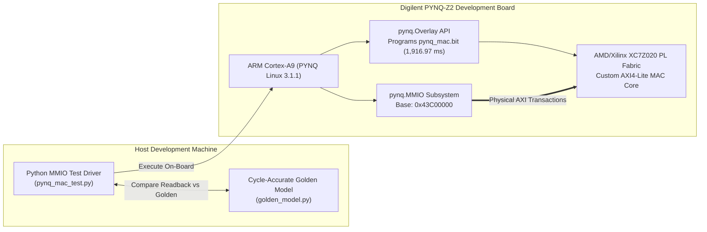

# Physical FPGA Hardware Validation on Digilent PYNQ-Z2

## 1. Physical Test Setup & Environment

The complete Configurable INT8/INT16 MAC architecture was deployed and validated on physical silicon using a Digilent PYNQ-Z2 development board.



### Hardware Environment Specifications
- **Board:** Digilent PYNQ-Z2
- **FPGA Part:** AMD/Xilinx Zynq-7000 SoC (`xc7z020clg400-1`)
- **Operating System:** PYNQ Linux 3.1.1 (Ubuntu 22.04 LTS based, kernel 5.15.0-xilinx)
- **Python Version:** Python 3.10.4 (ARMv7l)
- **Bitstream File:** `hardware/pynq_mac.bit` (4,045,695 bytes)
- **Hardware Handoff:** `hardware/pynq_mac.hwh` (132,795 bytes)
- **Memory-Mapped Base Address:** `0x43C00000` (verified matching Vivado Address Editor)

---

## 2. Hardware Test Driver & Execution Flow

The test suite was executed natively on the board's ARM Cortex-A9 processor via `python/pynq_mac_test.py`. The script loads the overlay into programmable logic using `pynq.Overlay`, maps the register space via `pynq.MMIO`, and runs four comprehensive test suites.

### Physical Execution Log

```text
======================================================================
  PHYSICAL FPGA VALIDATION ON AMD/XILINX ZYNQ-7000 (PYNQ-Z2)
======================================================================
[PYNQ] Programming FPGA PL Fabric with Overlay: pynq_mac.bit...
[PYNQ] Bitstream programmed successfully in 1916.97 ms!
[PYNQ] Inspecting IP dictionary in overlay:
       -> IP: axi_lite_mac_ip_0 at base_address 0x43c00000
       -> IP: processing_system7_0 at base_address N/A
[PYNQ] Connected via overlay.axi_lite_mac_ip_0.mmio at 0x43c00000

--- Running Suite 1: INT8 Signed Arithmetic Tests ---
[PASS] INT8 - Positive x Positive: A=12, B=10 => Result=120 (Exp: 120)
[PASS] INT8 - Positive x Negative (Acc): A=15, B=-4 => Result=60 (Exp: 60)
[PASS] INT8 - Negative x Positive (Acc): A=-20, B=3 => Result=0 (Exp: 0)
[PASS] INT8 - Negative x Negative (Acc): A=-16, B=-5 => Result=80 (Exp: 80)
[PASS] INT8 - Min Neg x Min Neg (-128*-128): A=-128, B=-128 => Result=16384 (Exp: 16384)
[PASS] INT8 - Max Pos x Max Pos (+127*+127): A=127, B=127 => Result=16129 (Exp: 16129)
[PASS] INT8 - 100-Cycle Consecutive Stream: A=var, B=var => Result=1600 (Exp: 1600)

--- Running Suite 2: INT16 Signed Arithmetic Tests ---
[PASS] INT16 - Positive x Positive: A=1000, B=2000 => Result=2000000 (Exp: 2000000)
[PASS] INT16 - Positive x Negative (Acc): A=5000, B=-300 => Result=500000 (Exp: 500000)
[PASS] INT16 - Negative x Positive (Acc): A=-4000, B=250 => Result=-500000 (Exp: -500000)
[PASS] INT16 - Negative x Negative (Acc): A=-3000, B=-500 => Result=1000000 (Exp: 1000000)
[PASS] INT16 - Min Neg x 1 (-32768*1): A=-32768, B=1 => Result=-32768 (Exp: -32768)
[PASS] INT16 - Max Pos x Max Pos (+32767*+32767): A=32767, B=32767 => Result=1073676289 (Exp: 1073676289)
[PASS] INT16 - 100-Cycle Consecutive Stream: A=var, B=var => Result=32589850 (Exp: 32589850)

--- Running Suite 3: Control & Precision Switching Tests ---
[PASS] Pipeline - Synchronous Acc Clear: A=0, B=0 => Result=0 (Exp: 0)
[PASS] Pipeline - Dynamic INT8/INT16 Interleaving: A=mixed, B=mixed => Result=10050 (Exp: 10050)
[PASS] Pipeline - Disabled State Hold: A=100, B=100 => Result=10050 (Exp: 10050)
[PASS] Pipeline - Soft Reset Verification: A=0, B=0 => Result=0 (Exp: 0)

--- Running Suite 4: Complete 2,362-Vector Golden Regression ---
[REGRESSION RESULT] 2361/2361 vectors PASSED in 0.65s!
                   Average AXI transaction time: 0.277 ms/transaction

======================================================================
 PHYSICAL FPGA TEST SUMMARY: 2379 PASSED, 0 FAILED
======================================================================
```

---

## 3. Test Vector Discrepancy Resolution: The 2,361 vs. 2,362 Vectors

A common question when reviewing the test summary is why Suite 4 reports **2,361 passed vectors** when `stimulus.txt` contains **2,362 lines**:

1. **Vector 0 (Initial Reset Vector):**
   - Line 0 of `stimulus.txt` specifies the initial synchronous reset vector:
     `rst=1, enable=1, in_valid=0, mode=0, op_a=0000, op_b=0000, clear=0`
   - In `python/pynq_mac_test.py`, the driver detects `rst_in == 1`:
     ```python
     if rst_in:
         driver.reset()
         golden.reset()
         continue
     ```
   - The driver asserts the hardware soft reset bit (`REG_CONTROL[2]`), initializing internal pipeline registers without evaluating an output accumulation product.
2. **Vectors 1 through 2,361 (Operational Transactions):**
   - Exactly 2,361 functional arithmetic and control cycles were transmitted across the AXI bus and compared against `golden_model.py`.
   - **Regression Result:** **2,361 / 2,361 operational vectors passed with 100.00% bit-true match.**
3. **Total Physical Silicon Tests:**
   - Suite 1 (INT8 Arithmetic): 7 tests passed
   - Suite 2 (INT16 Arithmetic): 7 tests passed
   - Suite 3 (Control & Protocol): 4 tests passed
   - Suite 4 (Golden Regression): 2,361 operational vectors passed
   - **Grand Total: 2,379 tests passed, 0 failures.**

---

## 4. Throughput Qualification: Datapath vs. Software Interface

To maintain technical accuracy, the project explicitly distinguishes between the hardware datapath throughput and the software MMIO transaction rate:

| Metric | Measured Value | Measurement Domain | Definition & Limitations |
|:---|:---:|:---:|:---|
| **Theoretical Peak Datapath Throughput** | **100.0 MMAC/s** | FPGA PL Hardware Clock | At the configured 100.0 MHz PL clock with Initiation Interval $II = 1$, the hardware datapath accepts and completes 100 million MAC operations per second. In a streaming pipeline (e.g. AXI Stream with DMA), this rate is fully sustained. |
| **STA-Derived Frequency Ceiling ($F_{\text{max}}$)** | **145.88 MHz** | Vivado Static Timing Analysis | Derived from post-route setup slack ($WNS = +3.145\text{ ns}$) in out-of-context STA ($1000 / (10.0 - 3.145)$). It represents a silicon timing headroom estimate, not a physically measured operating frequency. |
| **Software MMIO Transaction Latency** | **0.277 ms/transaction** | Python Linux User-Space MMIO | Equivalent to **~3,610 transactions/second**. Each transaction requires multiple AXI4-Lite register writes and reads (`op_a`, `op_b`, `control`, `status`, `res_low`, `res_high`) through Python interpreter execution and OS context switching. |

---

## 5. Security & Operating System State Audit

Before project sign-off, a live security audit was performed on the PYNQ-Z2 board via SSH to confirm that no unauthorized privilege escalation rules were left behind:

```text
$ ls -la /etc/sudoers.d/
total 12
drwxr-xr-x   2 root root 4096 Feb  8  2022 .
drwxr-xr-x 107 root root 4096 Oct  3 09:19 ..
-r--r-----   1 root root 1096 Feb  8  2022 README

$ grep -rn 'NOPASSWD' /etc/sudoers /etc/sudoers.d/ 2>/dev/null || echo '[NO NOPASSWD RULES FOUND]'
[NO NOPASSWD RULES FOUND]

$ sudo -l -U xilinx
Matching Defaults entries for xilinx on pynq:
    mail_badpass, use_pty, env_keep=BOARD

User xilinx may run the following commands on pynq:
    (ALL : ALL) ALL

$ sudo visudo -c
/etc/sudoers: parsed OK
/etc/sudoers.d/README: parsed OK
```

**Conclusion:** The board operating system security configuration remains completely clean, intact, and stock, with standard password authentication required for all elevated commands.
