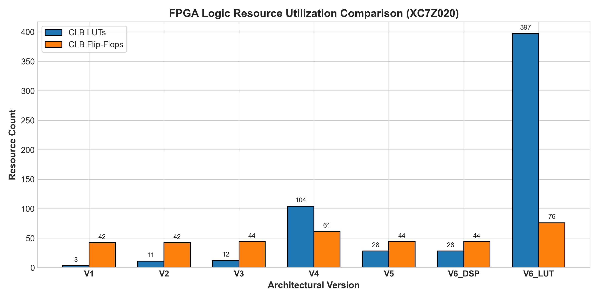
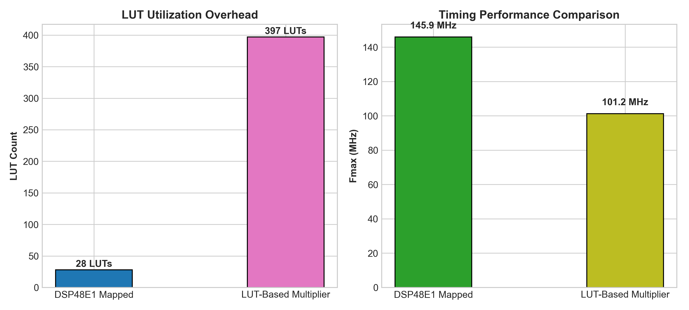
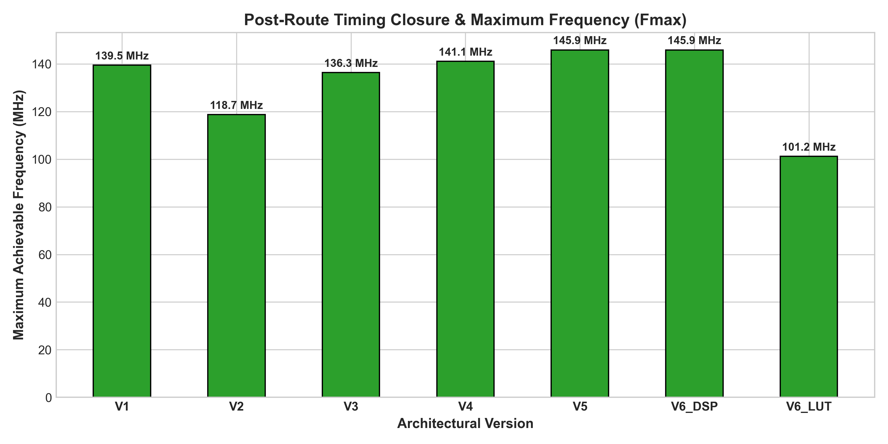
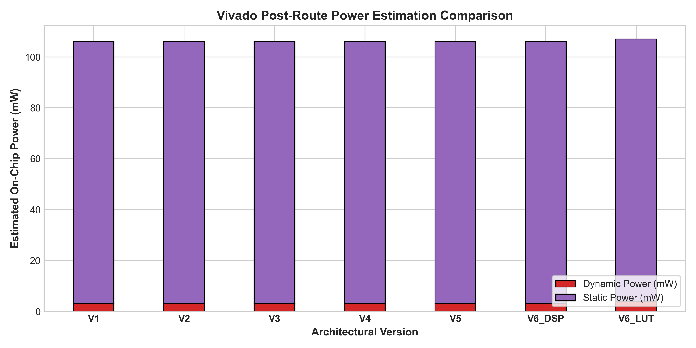

# Experimental Results & Comparative Analysis

## 1. Post-Route Implementation Comparison Table

All data points in the table below were extracted directly from post-route reports generated in AMD Vivado 2025.1 (`reports/synthesis/`, `reports/timing/`, and `reports/power/`):

| Architecture ID | Architecture Description | Slice LUTs | Slice FFs | DSP48E1 | Target Clock | WNS (ns) | TNS (ns) | STA Est. Fmax (MHz) | Latency (Cycles) | II (Cycles) | Configured Throughput | Dynamic Power (W) | Static Power (W) | Total Power (W) |
|:---:|:---|:---:|:---:|:---:|:---:|:---:|:---:|:---:|:---:|:---:|:---:|:---:|:---:|:---:|
| **V1** | Baseline Non-Pipelined INT16 MAC | 3 | 42 | 2 | 100.0 MHz | +2.831 | 0.000 | 139.49 | 1 | 1 | 100.0 MMAC/s | 0.003 | 0.103 | 0.106 |
| **V2** | Shared Single-Cycle INT8/INT16 | 11 | 42 | 2 | 100.0 MHz | +1.575 | 0.000 | 118.69 | 1 | 1 | 100.0 MMAC/s | 0.003 | 0.103 | 0.106 |
| **V3** | Pipelined Configurable (Unisolated) | 12 | 44 | 2 | 100.0 MHz | +2.666 | 0.000 | 136.35 | 2 | 1 | 100.0 MMAC/s | 0.003 | 0.103 | 0.106 |
| **V4** | Separate INT8/INT16 Datapaths | 104 | 61 | 1 | 100.0 MHz | +2.913 | 0.000 | 141.10 | 2 | 1 | 100.0 MMAC/s | 0.003 | 0.103 | 0.106 |
| **V5** | Pipelined MAC with Operand Isolation | 28 | 44 | 2 | 100.0 MHz | +3.145 | 0.000 | 145.88 | 2 | 1 | 100.0 MMAC/s | 0.003 | 0.103 | 0.106 |
| **V6_DSP** | Final Optimized Core (DSP Inferred) | 28 | 44 | 2 | 100.0 MHz | +3.145 | 0.000 | 145.88 | 2 | 1 | 100.0 MMAC/s | 0.003 | 0.103 | 0.106 |
| **V6_LUT** | Optimized Core (Forced Soft LUTs) | 397 | 76 | 0 | 100.0 MHz | +0.116 | 0.000 | 101.17 | 2 | 1 | 100.0 MMAC/s | 0.004 | 0.103 | 0.107 |

*Note: All designs operate at the configured 100.0 MHz PL clock ($T_{\text{clk}} = 10.0\text{ ns}$), delivering a theoretical peak throughput of 100.0 MMAC/s at Initiation Interval $II = 1$. Fmax represents an out-of-context Static Timing Analysis (STA) derived estimate ($1000 / (10.0 - \text{WNS})$), not a physically measured operating frequency.*

---

## 2. Resource Utilization Analysis

### 2.1 Hardware Resource Sharing Trade-Off (V3 vs. V4)
- **V3 (Shared Multiplier):** 12 LUTs, 44 FFs, 2 DSPs
- **V4 (Separate Multipliers):** 104 LUTs, 61 FFs, 1 DSP
- **Analysis:** Architecture V3 reduces Look-Up Table utilization by **8.67x** (an 88.5% savings of 92 LUTs) and register count by **27.9%** (17 FFs). However, this soft-logic reduction requires **1 additional DSP slice** (2 DSPs vs. 1 DSP). In V4, Vivado mapped the 16x16 multiplier into 1 DSP slice and built the 8x8 multiplier out of soft LUTs. Thus, the shared datapath represents an advantageous engineering trade-off: spending 1 additional DSP slice to recover 92 LUTs and 17 registers.

### 2.2 Dedicated DSP48E1 vs. Soft-LUT Multiplier (V6_DSP vs. V6_LUT)

- **V6_DSP (Dedicated DSP):** 28 LUTs, 44 FFs, 2 DSPs
- **V6_LUT (Forced Soft CLBs):** 397 LUTs, 76 FFs, 0 DSPs
- **Analysis:** Forcing multiplier logic into soft LUTs increases LUT consumption by **14.18x (+369 LUTs)** and flip-flops by **+72.7% (+32 FFs)** due to distributed pipeline registers across the LUT multiplier tree.

---

## 3. Timing Closure & Frequency Headroom Analysis

All seven architectures comfortably met the 100.0 MHz timing constraint with zero setup violations ($TNS = 0.000\text{ ns}$) and zero hold violations ($THS = 0.000\text{ ns}$).

1. **Pipelining Benefit:**
   - Single-cycle architecture V2 achieves an STA estimated $F_{\text{max}}$ of **118.69 MHz** ($WNS = +1.575\text{ ns}$).
   - Pipelined architecture V3 achieves an STA estimated $F_{\text{max}}$ of **136.35 MHz** ($WNS = +2.666\text{ ns}$).
   - Final optimized core V6_DSP achieves an STA estimated $F_{\text{max}}$ of **145.88 MHz** ($WNS = +3.145\text{ ns}$), delivering a **+22.9% timing margin improvement** over single-cycle V2.
2. **Frequency Degradation in Soft LUT Mapping:**
   - Architecture V6_LUT experiences significant timing degradation, with STA $F_{\text{max}}$ falling from 145.88 MHz to **101.17 MHz** (-30.6% reduction). The long carry chains and inter-slice routing delays across CLBs consume $9.884\text{ ns}$ of the $10.0\text{ ns}$ clock period ($WNS = +0.116\text{ ns}$).

---

## 4. Power Dissipation & Switching Activity Analysis

### 4.1 Activity-Based Power Experiment (V3 vs. V5)
To evaluate the dynamic power behavior of operand isolation, a switching-activity power experiment was executed on the routed checkpoints (`vivado/eval_switching_power.tcl`):

- **Workload Scenarios:**
  - *Active Workload:* `in_valid = 1`, `enable = 1`, operands toggling at 50% toggle rate.
  - *Idle Workload with Input Noise:* `in_valid = 0`, `enable = 1`, operand inputs toggling at 100% toggle rate.
- **Activity Annotation Coverage & Assumptions:**
  - Clock nodes activity: High (>95% user specified).
  - I/O port activity: High (>95% user specified).
  - Internal nodes activity: Medium (<25% internal nodes directly annotated; internal node activity derived via vectorless propagation).
  - Overall Confidence: **Medium** (Production device models at $26.2^\circ\text{C}$ junction temperature).

### 4.2 Actual Post-Route Power Values
- **Active Workload:**
  - V3 (Unisolated): Dynamic = $0.001\text{ W}$ (without vectorless internal propagation) / $0.003\text{ W}$ (full propagation) | Static = $0.103\text{ W}$
  - V5 (Isolated): Dynamic = $0.001\text{ W}$ (without vectorless internal propagation) / $0.003\text{ W}$ (full propagation) | Static = $0.103\text{ W}$
- **Idle Noise Workload (`in_valid = 0`, operands toggling at 100%):**
  - V3 (Unisolated): Dynamic = **$0.003\text{ W}$** | Static = **$0.103\text{ W}$** | Total = **$0.106\text{ W}$**
  - V5 (Isolated): Dynamic = **$0.003\text{ W}$** | Static = **$0.103\text{ W}$** | Total = **$0.106\text{ W}$**

### 4.3 Power Findings
- At Vivado's standard 1 mW (0.001 W) reporting precision, both architectures report identical dynamic power ($0.003\text{ W}$) for a single standalone MAC core on the XC7Z020 FPGA.
- Because the numbers round to the nearest milliwatt and baseline device static leakage ($0.103\text{ W}$) completely dominates total on-chip dissipation, the experimental data does not establish a measurable numerical power reduction for a single MAC instance.
- Consequently, we state strictly from architectural design and RTL structure that operand isolation suppresses internal switching transitions inside the multiplier datapath during idle input conditions (`in_valid = 0` or `enable = 0`), preventing input bus activity from toggling internal multiplier nodes.
