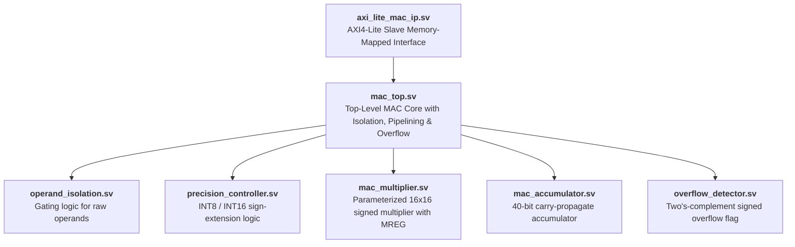

# SystemVerilog RTL Module Walkthrough

## 1. Source Hierarchy Overview

The hardware implementation consists of 12 synthesizable SystemVerilog modules organized into modular arithmetic building blocks, full datapath variants, and the top-level AXI4-Lite IP wrapper.



---

## 2. Core Arithmetic Modules

### 2.1 `operand_isolation.sv`
- **Purpose:** Prevents dynamic switching power dissipation in downstream multiplier logic when the core is inactive or unselected.
- **Interface:**
  - Inputs: `enable`, `in_valid`, `raw_operand_a[15:0]`, `raw_operand_b[15:0]`
  - Outputs: `isolated_operand_a[15:0]`, `isolated_operand_b[15:0]`
  - Parameter: `ENABLE_ISOLATION` (default `1'b1`)
- **Operation:**
  ```systemverilog
  assign gate_condition = enable & in_valid;
  assign isolated_operand_a = (ENABLE_ISOLATION && !gate_condition) ? 16'h0000 : raw_operand_a;
  assign isolated_operand_b = (ENABLE_ISOLATION && !gate_condition) ? 16'h0000 : raw_operand_b;
  ```
  When `gate_condition` is false, output operand lines are tied to zero, completely suppressing transition activity at the multiplier inputs.

---

### 2.2 `precision_controller.sv`
- **Purpose:** Dynamically steers precision and performs two's-complement sign-extension.
- **Interface:**
  - Inputs: `precision_mode`, `operand_a[15:0]`, `operand_b[15:0]`
  - Outputs: `ext_operand_a[15:0]`, `ext_operand_b[15:0]` (signed)
- **Operation:**
  - `precision_mode = 1'b0` (INT8):
    ```systemverilog
    ext_operand[15:0] = {{8{operand[7]}}, operand[7:0]};
    ```
    Bits `[7:0]` are treated as signed 8-bit integers and sign-extended across the upper 8 bits.
  - `precision_mode = 1'b1` (INT16):
    ```systemverilog
    ext_operand[15:0] = operand[15:0];
    ```
    The full 16-bit signed operand is passed through directly.

---

### 2.3 `mac_multiplier.sv`
- **Purpose:** Computes the 32-bit signed product of two 16-bit operands with optional pipeline register insertion.
- **Parameters:**
  - `USE_DSP` (string, default `"auto"`): Guides Vivado synthesis attribute `(* use_dsp = USE_DSP *)` to select dedicated DSP48E1 slices or soft CLB logic.
  - `PIPELINED` (bit, default `1'b1`): Inserts the pipeline register `MREG`.
- **Operation:**
  Computes signed product:
  ```systemverilog
  product_comb = signed_a * signed_b;
  ```
  When `PIPELINED = 1'b1`, `product_comb`, `in_valid`, and `acc_clear` are registered on `posedge clk` when `enable = 1`.

---

### 2.4 `mac_accumulator.sv`
- **Purpose:** Maintains the 40-bit running accumulation sum with synchronous clearing and enable gating.
- **Interface:**
  - Inputs: `clk`, `rst`, `enable`, `clear`, `valid_in`, `product_in[31:0]` (signed)
  - Outputs: `accumulator_out[39:0]` (signed), `valid_out`
- **Operation:**
  ```systemverilog
  always_ff @(posedge clk) begin
      if (rst) begin
          accumulator_out <= 40'sh0;
          valid_out       <= 1'b0;
      end else if (enable) begin
          valid_out <= valid_in;
          if (clear) begin
              // Synchronous clear: replace accumulator with current incoming product
              accumulator_out <= {{8{product_in[31]}}, product_in};
          end else if (valid_in) begin
              // Accumulate sign-extended 32-bit product onto 40-bit running sum
              accumulator_out <= accumulator_out + {{8{product_in[31]}}, product_in};
          end
      end
  end
  ```

---

### 2.5 `overflow_detector.sv`
- **Purpose:** Identifies two's-complement arithmetic overflow during 40-bit addition.
- **Interface:**
  - Inputs: `acc_current[39:0]`, `product[39:0]`, `sum[39:0]`
  - Outputs: `overflow_status`
- **Logic:**
  ```systemverilog
  assign overflow_status = (~acc_current[39] & ~product[39] &  sum[39]) |
                           ( acc_current[39] &  product[39] & ~sum[39]);
  ```
  Asserts high if two positive numbers yield a negative sum, or two negative numbers yield a positive sum.

---

## 3. Top-Level Datapath & Architectural Variants

### 3.1 `mac_top.sv` (Production Core V6)
The production core instantiates `operand_isolation`, `precision_controller`, `mac_multiplier`, `mac_accumulator`, and `overflow_detector`. It accepts operands on clock cycle 0 and produces a verified 40-bit accumulation result on clock cycle 2 with an Initiation Interval of 1 cycle (II = 1).

### 3.2 Evaluation Variants (V1–V5, V6_LUT)
- `mac_basic.sv` (V1): Baseline single-cycle non-pipelined INT16-only MAC.
- `mac_configurable.sv` (V2): Single-cycle INT8/INT16 configurable MAC with sign-extension.
- `mac_pipelined.sv` (V3): Shared 16x16 multiplier with MREG pipeline registers, but without operand isolation.
- `mac_separate_datapaths.sv` (V4): Independent 8x8 and 16x16 multipliers with output multiplexing.
- `mac_pipelined_isolated.sv` (V5): Shared pipelined MAC with dynamic operand isolation enabled.

---

## 4. SoC Integration Wrapper: `axi_lite_mac_ip.sv`

This module wraps `mac_top.sv` with a standard 32-bit AXI4-Lite slave interface conforming to the AMBA AXI protocol.

### Register Memory Map (Base Address: `0x43C00000`)

| Byte Offset | Register Name | Access | Bit Field Definitions |
|:---:|:---|:---:|:---|
| `0x00` | `REG_CONTROL` | R/W | `[0]`: Enable core (`1` = active)<br>`[1]`: Clear Accumulator (synchronous pulse)<br>`[2]`: Soft Reset (`1` = active)<br>`[3]`: Valid Strobe (`1` = execute transaction) |
| `0x04` | `REG_MODE` | R/W | `[0]`: Precision Mode (`0` = INT8, `1` = INT16) |
| `0x08` | `REG_OPERAND_A` | R/W | `[15:0]`: Multiplicand Operand A (Signed two's complement) |
| `0x0C` | `REG_OPERAND_B` | R/W | `[15:0]`: Multiplier Operand B (Signed two's complement) |
| `0x10` | `REG_STATUS` | RO | `[0]`: Busy flag<br>`[1]`: Output Valid (`out_valid`)<br>`[2]`: Signed Overflow flag (`overflow_status`) |
| `0x14` | `REG_RESULT_LOW`| RO | `[31:0]`: Lower 32 bits of 40-bit Accumulator Result |
| `0x18` | `REG_RESULT_HIGH`| RO | `[7:0]`: Upper 8 bits of 40-bit Accumulator Result (Sign-extended to 32 bits) |

### Handshake & Transaction Protocol
When `REG_CONTROL[3]` (`in_valid`) is strobed high with operands loaded into `REG_OPERAND_A` and `REG_OPERAND_B`, the wrapper presents the operands to the internal datapath. After 2 clock cycles, the internal core asserts `out_valid`, latching the 40-bit result into `REG_RESULT_LOW` and `REG_RESULT_HIGH` and setting `REG_STATUS[1]` high for the host processor to read.
