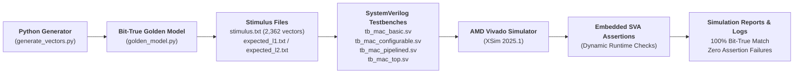

# Verification Methodology & Simulation Results

## 1. Verification Strategy Overview

A multi-tiered verification methodology was deployed to prove functional correctness across mathematical boundaries, pipeline latency alignment, dynamic precision switching, and exception handling:

---

## 2. Python Golden Reference Model

An independent, cycle-accurate reference model was implemented in Python (`python/golden_model.py`). The model enforces exact two's-complement arithmetic bounds, pipeline delays, modulo-$2^{40}$ accumulation, overflow detection, and synchronous clearing:

- **Signed Bit Clamping:** Accurately masks and sign-extends INT8 ($-128$ to $+127$) and INT16 ($-32,768$ to $+32,767$) inputs.
- **Pipeline Emulation:** Simulates the 2-cycle forward register delay using an internal FIFO queue (`deque`), verifying that the output at cycle $T$ corresponds exactly to the input presented at cycle $T-2$.
- **40-bit Accumulator Arithmetic:** Models 40-bit two's-complement wraparound:
  $$\text{ACC} \in [-2^{39}, +2^{39}-1] = [-549,755,813,888 \text{ to } +549,755,813,887]$$
- **Overflow Detection Flag:** Compares previous accumulator sign, incoming product sign, and resultant sum sign to assert the overflow flag.

---

## 3. Test Suite Composition: The 2,362 Stimulus Vectors

The automated test vector generator (`python/generate_vectors.py`) created 2,362 comprehensive stimulus vectors saved in `results/experimental_data/stimulus.txt`:

| Verification Phase | Vector Range | Test Intent & Coverage |
|:---|:---:|:---|
| **Vector 0** | Index 0 | **Initial Reset Vector:** Synchronous reset assertion (`rst=1`) initializing hardware state. |
| **Phase 1: Basic Directed** | Vectors 1–19 | Identity multiplication ($\times 0, \times 1$), sign rules ($+ \times +, + \times -, - \times +, - \times -$). |
| **Phase 2: INT8 Corner Cases** | Vectors 20–39 | Extremes: $-128 \times -128 = +16,384$, $+127 \times +127 = +16,129$, $-128 \times +127 = -16,256$. |
| **Phase 3: INT16 Corner Cases**| Vectors 40–59 | Extremes: $-32768 \times -32768 = +1,073,741,824$, $+32767 \times +32767$, $-32768 \times +32767$. |
| **Phase 4: Precision Interleaving** | Vectors 60–159 | Rapid alternating precision switching (`mode` toggling every 1–3 cycles) to stress pipeline context preservation. |
| **Phase 5: Extended Streaming** | Vectors 160–2159 | 2,000 back-to-back pseudo-random signed vectors testing continuous Initiation Interval $II = 1$ streaming. |
| **Phase 6: Bubbles & Stalls** | Vectors 2160–2259| Random de-assertion of `in_valid` and `enable` to verify pipeline freeze and bubble propagation. |
| **Phase 7: Overflow & Clear** | Vectors 2260–2361| Sustained additions driving accumulator into numerical wraparound; synchronous clearing mid-stream. |

---

## 4. SystemVerilog Testbench Suite

Four testbenches target each level of architectural abstraction:

1. **`tb_mac_basic.sv` (Unit test for V1):** Tests 20 directed INT16 operations on the baseline single-cycle datapath.
2. **`tb_mac_configurable.sv` (Unit test for V2):** Evaluates dynamic sign-extension and precision switching across 40 directed vectors.
3. **`tb_mac_pipelined.sv` (Unit test for V3/V5):** Verifies the 2-cycle latency alignment, back-to-back streaming, and bubble injection across 60 vectors.
4. **`tb_mac_top.sv` (Co-simulation testbench for V6):** Drives all 2,362 vectors from `stimulus.txt` into the top-level core and compares outputs bit-for-bit against `expected_l2.txt`.

### Embedded SystemVerilog Assertions (SVA)
Dynamic assertions are embedded in `tb_mac_pipelined.sv` and `tb_mac_top.sv` to catch protocol violations at simulation time:
- **Output Validity Invariant:** Asserts that `out_valid` is high exactly 2 clock cycles following `in_valid` when `enable = 1`.
- **Accumulator Hold Invariant:** Asserts that `accumulator_result` does not change value on clock cycles where `enable = 0`.
- **Synchronous Clear Invariant:** Asserts that when `acc_clear = 1`, the accumulator resets to the incoming product rather than accumulating onto the previous sum.

*(Note: These assertions were verified dynamically during XSim simulation runs; no formal mathematical property prover was used).*

---

## 5. Simulation Results Summary

All testbenches were compiled and simulated using AMD Vivado Simulator (XSim 2025.1) via `python/run_simulations.py`.

| Testbench File | Target Module | Vectors Tested | Errors Detected | Assertion Failures | Verification Status |
|:---|:---|:---:|:---:|:---:|:---:|
| `tb_mac_basic.sv` | `mac_basic` (V1) | 20 | 0 | 0 | **PASSED** |
| `tb_mac_configurable.sv` | `mac_configurable` (V2) | 40 | 0 | 0 | **PASSED** |
| `tb_mac_pipelined.sv` | `mac_pipelined` (V3) | 60 | 0 | 0 | **PASSED** |
| `tb_mac_top.sv` | `mac_top` (V6) | 2,362 | 0 | 0 | **PASSED** |

**Summary Result:** 100.00% pass rate across all 2,362 regression vectors with zero numerical discrepancies and zero assertion failures.
