# AMD Vivado Synthesis, Implementation & SoC Packaging

## 1. Target Hardware & Toolchain Specifications

- **EDA Tool:** AMD Vivado Design Suite 2025.1 (win64 Build 6140274)
- **Target FPGA Board:** Digilent PYNQ-Z2
- **FPGA Silicon:** AMD/Xilinx Zynq-7000 SoC (`xc7z020clg400-1`)
  - Logic Cells: 85,000
  - Slice LUTs: 53,200
  - Slice Registers (FFs): 106,400
  - DSP48E1 Slices: 220
  - Block RAM: 140 tiles (4.9 Mb)
  - Processing System: Dual-Core ARM Cortex-A9 @ 650 MHz

---

## 2. Implementation Methodology

Two distinct implementation flows were executed in Vivado:

```mermaid
graph TD
    subgraph Flow1 ["Flow 1: Out-of-Context Core Evaluation (V1–V6_LUT)"]
        RTL1["RTL Source Modules<br/>(rtl/*.sv)"] --> SYNTH1["synth_design -mode out_of_context"]
        XDC1["Timing Constraints<br/>(constraints/mac_timing.xdc)"] --> SYNTH1
        SYNTH1 --> OPT1["opt_design"]
        OPT1 --> PLACE1["place_design"]
        PLACE1 --> PHYS1["phys_opt_design"]
        PHYS1 --> ROUTE1["route_design"]
        ROUTE1 --> RPT1["report_utilization<br/>report_timing_summary<br/>report_power"]
    end

    subgraph Flow2 ["Flow 2: Zynq SoC Overlay Generation"]
        RTL2["Custom MAC Core & Wrapper<br/>(rtl/axi_lite_mac_ip.sv)"] --> PKG["IP Packager (package_mac_ip.tcl)<br/>vendor: xilinx.com, library: user"]
        PKG --> BD["Block Design (build_pynq_overlay.tcl)<br/>PS7 + Interconnect + Reset + Custom IP"]
        BD --> FULL_SYNTH["launch_runs synth_1"]
        FULL_SYNTH --> FULL_IMPL["launch_runs impl_1 -to_step write_bitstream"]
        FULL_IMPL --> BIT["Bitstream & Hardware Handoff<br/>hardware/pynq_mac.bit (4,045,695 B)<br/>hardware/pynq_mac.hwh (132,795 B)"]
    end
```

### Flow 1: Out-of-Context Core Evaluation
To evaluate pure datapath silicon utilization and timing independent of I/O pad buffers or interconnect logic, architectures V1 through V6_LUT were synthesized in out-of-context (`-mode out_of_context`) mode.
- Timing Constraint: 100.0 MHz clock ($T_{\text{clk}} = 10.0\text{ ns}$) applied on the `clk` port in `constraints/mac_timing.xdc`.
- Tcl automation scripts: `tcl/run_V1.tcl` through `tcl/run_V6_LUT.tcl`.

### Flow 2: Complete Zynq SoC Overlay Generation
The production core was packaged as an AXI4-Lite IP and integrated into a full Zynq Processing System block design to generate the physical FPGA bitstream.

---

## 3. IP Packaging & Block Design Architecture

### 3.1 Custom IP Packaging (`tcl/package_mac_ip.tcl`)
The AXI4-Lite MAC wrapper (`rtl/axi_lite_mac_ip.sv`) was packaged into an IP-XACT component:
- **VLNV:** `xilinx.com:user:axi_lite_mac_ip:1.0`
- **Bus Interface:** Slave AXI4-Lite (`s_axi`) clocked by `s_axi_aclk` with active-low reset `s_axi_aresetn`.
- **IP Output Directory:** `vivado/ip_repo/axi_lite_mac_ip`

### 3.2 Zynq-7000 SoC Block Design (`tcl/build_pynq_overlay.tcl`)
The block design `pynq_mac_bd` instantiates:
1. **Processing System 7 (`processing_system7_0`):**
   - Fabric clock `FCLK_CLK0` configured at **$100.0\text{ MHz}$**.
   - Master AXI GP0 interface (`M_AXI_GP0`) enabled for memory-mapped I/O communication.
   - DDR3 memory controller enabled (512 MB memory map for PYNQ Linux OS).
2. **AXI Interconnect (`axi_interconnect_0`):**
   - $1 \times 1$ interconnect connecting PS7 master port to MAC IP slave port.
3. **Processor System Reset (`rst_ps7_0_100M`):**
   - Synchronizes PS reset signals to `FCLK_CLK0`.
4. **Custom MAC Core (`axi_lite_mac_ip_0`):**
   - Address segment assigned: **`0x43C00000` - `0x43C0FFFF`** (64 KB range).

---

## 4. SoC Post-Route Implementation Metrics

The complete SoC design was placed, routed, and timing-closed. The raw reports are preserved in `hardware/reports/`:

| Resource / Parameter | Utilized | Available on XC7Z020 | Device Utilization (%) |
|:---|:---:|:---:|:---:|
| **Slice LUTs** | **495** | 53,200 | 0.93 % |
| **Slice Registers (FFs)** | **677** | 106,400 | 0.64 % |
| **DSP48E1 Slices** | **2** | 220 | 0.91 % |
| **Block RAM (RAMB36)** | **0** | 140 | 0.00 % |
| **Configured PL Clock Frequency** | **100.0 MHz** | - | - |
| **Worst Negative Slack (WNS)** | **+3.181 ns** | - | **0 Violations (MET)** |
| **Total Negative Slack (TNS)** | **0.000 ns** | - | **0 Violations (MET)** |
| **Worst Hold Slack (WHS)** | **+0.098 ns** | - | **0 Violations (MET)** |
| **Total Negative Hold Slack (THS)** | **0.000 ns** | - | **0 Violations (MET)** |
| **Total On-Chip Power** | **1.669 W** | - | - |
| **PS7 Dynamic Power** | **1.533 W** | - | 91.8% of total power |
| **PL Fabric Dynamic Power** | **0.004 W** | - | 0.2% of total power |
| **Device Static Leakage Power** | **0.136 W** | - | 8.1% of total power |

### Timing & Power Summary
- **Timing Closure:** With a positive slack of $WNS = +3.181\text{ ns}$ at 100 MHz, the SoC design comfortably closes timing with zero setup or hold violations.
- **Power Distribution:** Total chip power on the development board is $1.669\text{ W}$, overwhelmingly dominated by the dual ARM Cortex-A9 cores running PYNQ Linux ($1.533\text{ W}$, 91.8%). The custom MAC logic in the PL fabric accounts for only $0.004\text{ W}$ ($4\text{ mW}$).
